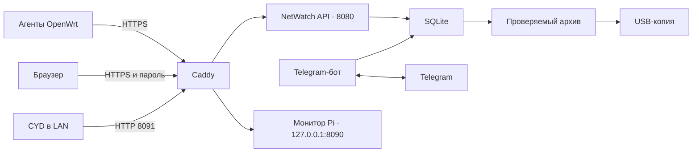

# NetWatch — эксплуатация и восстановление

Состояние на 16 ноября 2026 года. NetWatch собирает телеметрию OpenWrt, показывает состояние и историю в Telegram, а также выводит метрики Raspberry Pi в браузере и на CYD.

## Архитектура



- Главный роутер TR3000 обслуживает WAN, LAN, DHCP и локальный DNS. Он резервирует адрес Pi и перенаправляет WAN TCP 80 и 443 на Caddy. В домашней сети DNS возвращает локальный адрес Pi для того же домена, который используется из интернета.
- WR3000 работает как точка доступа в общей сети. DHCP и маршрутизация находятся на TR3000. Для локального резолвера WR используется исключение DNS rebind только для домена NetWatch.
- Caddy завершает TLS, перенаправляет HTTP на HTTPS и проксирует разрешённые маршруты. Защита паролем распространяется на страницу монитора и его API. Бэкенд монитора слушает только loopback. Для новой конфигурации шлюза достаточно пробросов 80 и 443.
- Агент хранит конфигурацию в `/etc/netwatch/config`, а исполняемый файл в `/etc/netwatch/agent3.sh`. Cron отправляет список клиентов каждые 20 секунд в ускоренном режиме или раз в минуту в обычном. Показатели здоровья отправляются каждые пять минут. Сервер и агент согласуют интервал, а переход между точками доступа одного аккаунта учитывается при расчёте статуса устройства. API проверяет секрет агента и принадлежность идентификатора роутера. Журнал агента доступен через `logread -e netwatch-agent`.

## Telegram

| Команда | Назначение |
| --- | --- |
| `/start`, `/guide` | Вход и инструкция для первого подключения |
| `/add_router` | Команда установки OpenWrt с кодом на 15 минут. Загружает закреплённую версию агента по HTTPS, проверяет SHA-256 и устанавливает недостающие зависимости через apk или opkg. При подтверждении существующей привязки сохраняет её |
| `/routers` | Список роутеров, состояние, число устройств, переименование и удаление с подтверждением |
| `/devices` | Список с пагинацией, карточка устройства, своё имя и переключатель уведомлений. При отсутствии своего имени бот может взять известное DHCP-имя того же MAC у этого пользователя с другой точки доступа |
| `/settings` | Массовое выключение переключателей online/offline у существующих устройств. Уведомления о новых устройствах продолжают работать. Отдельные переключатели управляют уведомлениями о состоянии роутеров и смене выбранного сервера Podkop |
| `/history` | Новые устройства и переходы online/offline устройств и роутеров. Присутствие устройства в истории оценивается по всем роутерам одного пользователя, поэтому обычный переход между точками доступа не должен создавать пару событий |
| `/health` | Интернет, Wi-Fi и число клиентов, CPU, RAM, состояние sing-box и задержка выбранного прокси Podkop, если замер доступен |
| `/admin` | Управление пользователями в личном чате, очистка данных с сохранением профиля или полное удаление, рассылка с подтверждением и ссылка на монитор |

Статус устройства обновляется независимо от его переключателя уведомлений. Podkop проверяется при очередном отчёте агента. Первое измерение фиксирует исходный сервер, последующие смены могут вызвать уведомление с предыдущей и новой задержкой, если оба замера доступны.

## Raspberry Pi

Рабочая система использует Debian 13 (Trixie), arm64, Python 3.13 и Caddy 2.11.7. Код API, бота и SQLite находится в `/opt/netwatch`. Настройки с секретами находятся в `/opt/netwatch/.env`. Основная база — `netwatch.db`. При наличии `netwatch_notify.db` она тоже входит в архив. Caddy использует `/etc/caddy/Caddyfile`, статические файлы — `/var/www/netwatch`. Монитор собирает CPU, температуру, RAM, диски, сеть, uptime, службы и доступные сведения о контейнерах.

```bash
systemctl is-active caddy netwatch-api netwatch-bot netwatch-monitor
journalctl -u netwatch-api -u netwatch-bot --since '10 minutes ago' --no-pager
```

При обновлении на рабочей Pi используйте `git fetch` и проверяйте конкретный коммит. Подготовьте кандидаты отдельно, проверьте синтаксис и прогоните миграции на копии SQLite. До замены сохраните рабочие файлы и базы. Выборочная установка сохраняет локальные изменения в рабочем дереве.

## Резервное копирование

`netwatch-backup.timer` запускает ежедневный бэкап в 02:00 по времени Pi (MSK). Каждый запуск создаёт отдельный архив с отметкой времени UTC в имени. Локальные архивы находятся в `/opt/netwatch/backups/scheduled`, копии на USB — в `/mnt/netwatch-backup/netwatch-backups`. NTFS-флешка монтируется по UUID через `/etc/fstab`. При недоступном USB локальный архив сохраняется, а ошибка копирования попадает в журнал. Веб-монитор показывает свободное место на смонтированных USB-накопителях и отмечает подключённые накопители без смонтированных разделов.

Скрипт использует SQLite Backup API для снимков работающих баз, проверяет целостность SQLite и контрольные суммы файлов в архиве. После копирования на USB сравнивается SHA-256 всего архива. Архив содержит код, настройки, базы, монитор, Caddyfile, статические файлы и сведения для восстановления служб и версий зависимостей. Это архив приложения, настроек и данных. Образ ОС, кэш сертификатов Caddy и полная конфигурация OpenWrt в него не входят.

Архивы хранятся без шифрования по принятому решению. В них есть секреты и данные пользователей, поэтому ограничьте физический доступ к USB и доступ к локальным архивам. Служба использует `NETWATCH_BACKUP_KEEP_DAYS=30`. Архивы старше 30 суток удаляются из каталогов плановых копий на Pi и USB после проверки нового бэкапа. Ручные резервные копии вне этих каталогов хранятся отдельно.

```bash
systemctl list-timers netwatch-backup.timer
findmnt --mountpoint /mnt/netwatch-backup
sudo systemctl start netwatch-backup.service
journalctl -u netwatch-backup.service -n 30 --no-pager
sudo python3 -IB /usr/local/lib/netwatch/backup_netwatch.py verify \
  /mnt/netwatch-backup/netwatch-backups/ARCHIVE.tar.gz
```

В последней команде подставьте имя одного архива. Плановый запуск в 02:00 MSK подтверждён 8 ноября 2026 года. USB-комплект обновлён 9 ноября из коммита `4777884`. Он включает расписание на 02:00 и хранение 30 суток. После восстановления проверьте обе настройки перед включением таймера.

## Восстановление на чистой Pi

1. Загрузите чистую Raspberry Pi OS на базе Debian 13 arm64 с Python 3.13 и доступом в интернет. На целевой системе должны отсутствовать предыдущие установки NetWatch и Caddy. Перед переключением остановите старую Pi, чтобы избежать конфликта IP и двух одновременно работающих экземпляров бота.
2. Подключите USB с каталогами `restore-kit` и `netwatch-backups`. Смонтируйте его и выберите конкретный архив. В командах ниже замените `ARCHIVE.tar.gz` на его имя. Первая команда проверяет и распаковывает архив в каталог подготовки.

   ```bash
   sudo sh /mnt/netwatch-backup/restore-kit/restore.sh \
     /mnt/netwatch-backup/netwatch-backups/ARCHIVE.tar.gz
   ```

3. Для установки на чистой Pi выполните ту же команду с `--apply`.

   ```bash
   sudo sh /mnt/netwatch-backup/restore-kit/restore.sh \
     /mnt/netwatch-backup/netwatch-backups/ARCHIVE.tar.gz --apply
   ```

   Комплект разворачивает приложение с виртуальным окружением Python, восстанавливает SQLite в `/var/lib/netwatch`, устанавливает Caddy, поднимает монитор и службы. Caddy получает сертификаты заново. При ошибке установки сохраните вывод и журнал для диагностики, перед повторным испытанием подготовьте чистый носитель.
4. Проверьте службы, отчёты обоих агентов, ответ Telegram на `/health` и веб-монитор из внешней сети. Проверьте, что анонимный запрос к странице и API монитора возвращает 401, а после входа данные обновляются. Настройте постоянное монтирование USB на новой Pi, запустите ручной бэкап и убедитесь, что копия прошла проверку. После этого включите таймер командой `sudo systemctl enable --now netwatch-backup.timer`.

## Настройка главного OpenWrt после замены

Сначала настройте рабочие WAN, LAN, DHCP и Wi-Fi. Профиль NetWatch рассчитан на главный шлюз с LAN /24 и зонами `lan` и `wan`. Подставьте в команды локальный IPv4 Pi и MAC того интерфейса Pi, который подключён к LAN. Команды предназначены для OpenWrt.

```sh
(
  set -e
  script=$(mktemp /tmp/netwatch-gateway.XXXXXX)
  trap 'rm -f "$script"' EXIT
  curl --disable --fail --silent --show-error --max-time 30 \
    --proto '=https' --output "$script" \
    https://raw.githubusercontent.com/zayacserj/netwatch-agent/19d54148d10404fb4021154ecd54a3d3e8fa4c49/ops/openwrt-netwatch-gateway.sh
  printf '%s  %s\n' \
    1436a42d5a24322c1d609be50ebc6f19ba29b034c3d9c4647be912ca32a36535 \
    "$script" | sha256sum -c -
  sh -n "$script"
  sh "$script" netwatchagent.duckdns.org PI_IPV4 PI_MAC
)
```

По умолчанию выполняется проверка. Если план изменений соответствует новой сети, повторите блок с последней командой `sh "$script" --apply netwatchagent.duckdns.org PI_IPV4 PI_MAC`. Скрипт проверяет конфликты, резервирует IP Pi, добавляет локальную DNS-запись и пробросы TCP 80/443. На действующем TR3000 проверка распознала все четыре правила с `add: 0`. Применение на чистом шлюзе и полное восстановление на чистой Pi ещё предстоит испытать. Проверка и распаковка USB-архива уже прошли. Отдельная проверка восстановления на чистом носителе остаётся открытой.

## CYD и журналы OpenWrt

CYD ESP32-2432S028 подключается к домашнему Wi-Fi и читает метрики Pi через отдельный LAN-маршрут Caddy на порту 8091. Веб-монитор и CYD используют один сборщик на 127.0.0.1:8090. Сборщик обновляет данные раз в 2 секунды. Порт 8091 остаётся в LAN. Доступ из интернета к веб-монитору требует входа через HTTPS.

TR3000 и WR3000 пишут в общий syslog на USB главного роутера. В 01:00 MSK TR3000 ротирует журнал в датированный файл и удаляет датированные журналы старше 30 дней. Работа ротации подтверждена владельцем.

## Windows Wizard

Wizard показывает шаги и команды для чистой Pi. При наличии архива он восстанавливает настройки и базы из этого архива. Без архива он разворачивает среду с пустой SQLite и запрашивает домен, Telegram-токен, ID администратора и пароль веб-монитора при установке. Нужны готовая Pi OS, SSH/SCP и интернет для зависимостей. Режим восстановления использует выбранный архив, а исходный комплект Caddy для новой установки доступен без рабочих секретов. LAN-маршрут CYD при чистой установке настраивается отдельно по инструкции.

## Ссылки

- [Веб-монитор Raspberry Pi](https://netwatchagent.duckdns.org/monitor/)
- [Рабочая ветка NetWatch](https://github.com/zayacserj/netwatch-agent/tree/master)
- [API](https://github.com/zayacserj/netwatch-agent/blob/master/deploy_files/api_fixed.py) · [SQLite](https://github.com/zayacserj/netwatch-agent/blob/master/deploy_files/db_fixed.py) · [Telegram-бот](https://github.com/zayacserj/netwatch-agent/blob/master/netwatch_telegram_bot.py)
- [Агент OpenWrt](https://github.com/zayacserj/netwatch-agent/blob/master/deploy_files/agent3_fixed.sh) · [Установка агента](https://github.com/zayacserj/netwatch-agent/blob/master/AGENT_DISTRIBUTION.md)
- [Веб-монитор](https://github.com/zayacserj/netwatch-agent/tree/master/monitor) · [Скетч CYD](https://github.com/zayacserj/netwatch-agent/tree/master/cyd)
- [Резервное копирование](https://github.com/zayacserj/netwatch-agent/blob/master/ops/BACKUP.md) · [Восстановление на чистой Pi](https://github.com/zayacserj/netwatch-agent/blob/master/docs/Restore-clean-Pi.md) · [Windows Wizard](https://github.com/zayacserj/netwatch-agent/tree/master/ops/windows-recovery)
- [Профиль главного шлюза OpenWrt](https://github.com/zayacserj/netwatch-agent/blob/master/ops/OPENWRT_GATEWAY.md)
